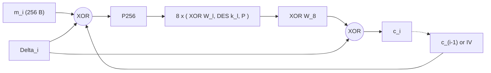

# Mathematical analysis of Odette 5.01

This analyses the wrapping scheme around DES, not DES itself. DES is treated as a keyed random permutation on 64-bit words. Everything below refers to the current code in [src/](src/) (the cipher is in [src/odette_cipher.cpp](src/odette_cipher.cpp)). Items marked **(measured)** were checked against the built binary or a model run for this revision (section 11). Claims about key-search cost are heuristic arguments about a custom construction that nobody has reviewed.

## 1. Summary

| Property | Result |
|---|---|
| Block width | 2048 bits (32 DES words); one plaintext bit reaches every word after 6 layers, one output word depends on every plaintext word after 5 layers, in both directions **(measured)** |
| Layers | 8 DES layers, 256 DES operations per 256-byte block |
| Keys | 8 DES keys (64 bytes); all 512 key bits feed the 2048-bit whitening and the per-block tweak |
| Per-block tweak | XEX: a secret 2048-bit mask, a PRF of key, salt and block index, XORed before and after the cipher. Every block is encrypted by its own permutation instance, used once |
| Generic key search | about $2^{512}$. No quantity an attacker can compute depends on a proper subset of the key bits, so no divide-and-conquer or meet-in-the-middle split exists (section 5.2) |
| Same cascade without whitening | $2^{224}$ time, from the 4\|4 split |
| Differential and linear attacks | need two pairs under one permutation instance; none exist. The core without the tweak would still resist them: best trail about $2^{-224}$ (section 6) |
| Chaining | CBC around all layers with a random 256-byte IV, inside the tweak |
| Randomisation | Salt, IV and padding are random: equal messages give unrelated ciphertexts **(measured)**; two files made with one key file share no whitening and no tweak |
| Integrity | HMAC-SHA-512 (512-bit key, 512-bit tag) over header and ciphertext, verified before decryption |
| Passphrase | scrypt (N=2^17, r=8, p=1, 128 MiB per guess), random salt; strength is the phrase entropy |
| 64-bit word collisions | occur at the random rate (about $2^{30}$ blocks) and carry no information, because the tweak masks every ciphertext word with a block-specific secret (section 8) |
| Speed | 1 MiB in 0.13 s each way; 16 MiB in 2.01 s each way, about 8 MB/s **(measured)** |
| Post-quantum | about $2^{256}$ Grover iterations for the cipher and the MAC, against $2^{128}$ for AES-256 (section 12); heuristic |

The key-search bound rests on one structural fact: every layer input, including the first and the last, is XORed with a pseudorandom function of **all** 512 key bits, so there is no partial-key test anywhere in the cipher. The tweak adds a second fact: no permutation instance is ever used for more than one block, so there is nothing for a multi-pair attack to compare.

## 2. Model

Let $D_k$ be DES-ECB applied to each of the 32 eight-byte words of a 256-byte block, and let $P_s$ be the keyless nibble swap on $s$-byte groups (section 3). The eight keys $k_0,\dots,k_7$ and nine whitening blocks $W_0,\dots,W_8$ (each 2048 bits) define the wide block cipher $G$:

$$s_0 = P_{256}(u),\qquad s_{l+1} = P_{g_l}\big(D_{k_l}(s_l \oplus W_l)\big)\ (l<7),\qquad G(u) = D_{k_7}(s_7\oplus W_7)\oplus W_8$$

with $g_l = 16\cdot 2^{\,l \bmod 5}$ bytes, that is 16, 32, 64, 128, 256, 16, 32 for $l=0,\dots,6$. With $K = k_0\|\cdots\|k_7$ (all 64 bytes) and the 16-byte salt from the file header, the whitening and the per-block tweak are

$$W_j = \mathrm{HMAC\text{-}SHA\text{-}512}_{K}\big(\text{"Odette 5.01 white"}\,\|\,\text{salt}\,\|\,j\,\|\,c\big)_{c=0..3},\qquad
\Delta_i = \mathrm{HMAC\text{-}SHA\text{-}512}_{K}\big(\text{"Odette 5.01 tweak"}\,\|\,\text{salt}\,\|\,i\,\|\,c\big)_{c=0..3},$$

four 64-byte outputs each, $i$ the 8-byte big-endian block index. The whitening costs 36 HMAC calls once per file; the tweak costs 4 per block, with the HMAC pad states computed once.

The message is encrypted in CBC mode around $G$, and each block is wrapped in its tweak (the XEX construction). For padded plaintext blocks $m_i$:

$$u_i = m_i \oplus c_{i-1},\qquad c_i = G(u_i \oplus \Delta_i)\oplus\Delta_i,\qquad c_{-1} = \mathrm{IV}$$

Decryption is $m_i = G^{-1}(c_i\oplus\Delta_i)\oplus\Delta_i\oplus c_{i-1}$. Writing $G_i(x) = G(x\oplus\Delta_i)\oplus\Delta_i$, the scheme is plain CBC over a family of permutations $G_0, G_1, \dots$ of which each member encrypts exactly one block.

The file is `OD\x05\x01 | log2 N, r, p, 0 | salt | IV | c_0 ... c_n | tag`: a 280-byte header, the blocks, and $\text{tag}=\mathrm{HMAC\text{-}SHA\text{-}512}(K_{mac},\ \text{everything before it})$, 64 bytes, with $K_{mac}$ a 512-bit key.

Key material by mode:

| | Key-file mode | Phrase mode |
|---|---|---|
| $K$ (DES keys) | the 64 bytes of the file | scrypt output bytes 0..63 |
| $K_{mac}$ | $\mathrm{HMAC\text{-}SHA\text{-}512}_K(\text{"Odette 5.01 mac"})$ | scrypt output bytes 64..127 |
| Salt | input to $W_j$ and $\Delta_i$ | input to scrypt, $W_j$ and $\Delta_i$ |
| Varies per file | salt, hence all $W_j$ and $\Delta_i$, and IV | salt, hence $K$, $K_{mac}$, all $W_j$, $\Delta_i$, and IV |

The three HMAC labels differ in their first bytes, so whitening, tweak and MAC key are domain-separated outputs of one PRF under $K$.

## 3. The expansion permutations

For a group of $s$ bytes and $i < s/2$, with $j = i + s/2$:

$$\text{new}[i] = (\text{old}[j] \,\&\, \mathtt{0x0F}) \ll 4 \;\big|\; (\text{old}[i] \,\&\, \mathtt{0x0F}),\qquad
\text{new}[j] = (\text{old}[j] \,\&\, \mathtt{0xF0}) \;\big|\; (\text{old}[i] \gg 4)$$

Properties, all checked on random blocks for $s = 16, 32, 64, 128, 256$ **(measured)**:

- **Bit permutation:** $P_s$ is linear over $\mathrm{GF}(2)$ and has no key. An attacker can apply or invert it freely.
- **Involution:** $P_s^2 = \mathrm{id}$.
- **Lane-preserving:** the byte position inside a 64-bit word never changes, because $s/2$ is a multiple of 8.
- **Pairing:** each layer pairs word $b$ with word $b \oplus \text{stride}$, taking half the nibbles from each.
- **Stay set:** in every $P_s$, exactly 32 of the 64 bit positions of a word stay in that word: the low nibbles for a word in the lower half of its group, the high nibbles for a word in the upper half. The other 32 move to the partner word. This number governs the best differential trail (section 6).

| Position | initial | after $D_0$ | $D_1$ | $D_2$ | $D_3$ | $D_4$ | $D_5$ | $D_6$ |
|---|---|---|---|---|---|---|---|---|
| Permutation | $P_{256}$ | $P_{16}$ | $P_{32}$ | $P_{64}$ | $P_{128}$ | $P_{256}$ | $P_{16}$ | $P_{32}$ |
| Stride (words) | 16 | 1 | 2 | 4 | 8 | 16 | 1 | 2 |

Read forwards, the strides after $D_0$ to $D_4$ are 1, 2, 4, 8, 16: each bit of the five-bit word index once, a butterfly. Read backwards from the ciphertext, the strides are 2, 1, 16, 8, 4: again each bit once. So the network is a butterfly in both directions, and the sixth to eighth layers repeat the pattern.

## 4. Diffusion

Modelling each DES layer as fully mixing its word, the word-level cones over all 2048 start bits are **(measured, model)**:

| After layer | 1 | 2 | 3 | 4 | 5 | 6 | 7 | 8 |
|---|---|---|---|---|---|---|---|---|
| Words reached by one plaintext bit | 1 | 2 | 4 | 8 | 16 | 32 | 32 | 32 |
| Words reached by one ciphertext bit (inverse layers 8 to 1) | 1 | 2 | 4 | 8 | 16 | 32 | 32 | 32 |
| Plaintext words that one output word of the layer depends on | 2 | 4 | 8 | 16 | 32 | 32 | 32 | 32 |

- The counts are identical for every start bit (min = max).
- The third row starts at 2 because $P_{256}$ precedes the first layer: every input word of $D_0$ already holds nibbles from two plaintext words.
- A single bit reaches the whole block at layer 6, and every output word depends on the whole plaintext at layer 5. Layers 7 and 8 are extra margin, not needed for diffusion. Symmetrically, from the ciphertext side layers 1 and 2 are margin.
- Hence every pair of consecutive layers can be regarded as "spare" from one side or the other, but no layer is spare from both sides: a trail must cross at least six fully diffusing layers.
- $c_i$ depends on $m_0,\dots,m_i$ and the IV. A change in $m_i$ changes about half of the bits of $c_i$, and since $c_i$ is the next chaining value, every later block changes too.

## 5. Key space and generic attacks

### 5.1 Cascade without whitening

With public permutations between the layers, a meet-in-the-middle split works: guess the keys of the first half from the plaintext side and of the second half from the ciphertext side. For $r$ layers the time is about $2^{56\lceil r/2\rceil}$. For $r=8$ that is $2^{224}$. Deriving the layer keys from a master key does not change this, because the attacker searches the layer keys directly.

### 5.2 Whitening and tweak derived from all key bits

The argument is simpler and stronger than a bit count. Under the assumption that HMAC-SHA-512 with a 512-bit key is a pseudorandom function:

1. Every layer input, including the plaintext side ($W_0$ and $\Delta_i$) and the ciphertext side ($W_8$ and $\Delta_i$), is XORed with a value that is a PRF output of the **whole** key $K$.
2. Any computation that produces a checkable quantity, from either end, must evaluate at least one DES word, and therefore must know at least one 64-bit word of some $W_l$ (and, at the outer layers, of $\Delta_i$).
3. A PRF output gives no information about any other output, and a partial key gives no information about any output. So knowing one word of one $W_l$ costs guessing all 512 bits of $K$.

Therefore **there is no partial-key test anywhere in the cipher**: no guess of fewer than 512 bits can be confirmed or refuted. This excludes meet-in-the-middle, divide-and-conquer over layers, and divide-and-conquer over words, and reduces the generic attack to brute force over $K$ at about $2^{512}$. The whitening cannot be solved for separately, because it is added before a nonlinear layer, so it is not removed by combining blocks; the tweak cannot be solved for either, because it differs for every block.

For completeness, a bit-count model treats every whitening word as 64 independent unknown bits and asks what a meet-in-the-middle at each cut would have to guess, ignoring the tweak. The cut sits at the output of $D_l$; the forward side needs the cone of one output word, the backward side the cone of the two words of $s_{l+1}$ that feed it (64 bits per whitening word, 56 per key, 64 per ciphertext word because of $W_8$):

| Cut after layer | Forward unknown bits | Backward unknown bits | Cost of the split ($\max$) |
|---|---|---|---|
| 1 | 120 | 10504 | $2^{10504}$ |
| 2 | 304 | 8400 | $2^{8400}$ |
| 3 | 616 | 6296 | $2^{6296}$ |
| 4 | 1184 | 3168 | $2^{3168}$ |
| 5 | 2264 | 1576 | $2^{2264}$ |
| 6 | 4368 | 752 | $2^{4368}$ |
| 7 | 6472 | 312 | $2^{6472}$ |

The numbers above $2^{512}$ are an artefact of treating the whitening as independent: a real attacker would guess $K$ instead. The table's only content is that every cut needs far more than 512 unknown bits on each side, which is the same conclusion as the PRF argument. As a check of the method, the same model applied to a hypothetical six-layer cascade without whitening gives $2^{168}$ at the 3|3 cut, matching $2^{56\lceil r/2\rceil}$.

### 5.3 DES-specific properties

- **Key bits.** DES ignores the lowest bit of each key byte, so the DES layers use 448 bits. The whitening reads all 64 bits of each key, so all 512 bits count. A key file that differs in one such bit fails authentication **(measured)**.
- **Complementation.** DES satisfies $D_{\bar k}(\bar x) = \overline{D_k(x)}$, which halves brute force on a plain DES cascade. Here complementing $K$ replaces every $W_l$ by an unrelated PRF output, so the property gives no saving.
- **Weak and semi-weak keys.** A weak key makes $D_k$ an involution. Random keys hit one with probability $2^{-52}$ per layer; with chosen key files it is the user's responsibility. Even then, the whitening between layers means no $D_k \circ D_k$ cancellation can occur.
- **Equivalent keys.** Two keys $K \ne K'$ give the same cipher only if they agree on all 448 DES bits and all nine $W_j$ and every $\Delta_i$ collide, which for a PRF has probability below $2^{-18432}$.

### 5.4 What this does not show

- It is a heuristic about cost, not a proof. It assumes there is no structural attack on XOR-whitened networks of DES words beyond guessing the unknowns.
- Security of whitening and tweak rests on HMAC-SHA-512 behaving as a pseudorandom function, an additional assumption beyond DES. In key-file mode the MAC key is a PRF output of the same $K$, so cipher and MAC are not independent.
- In phrase mode the real limit is the phrase entropy (section 8).
- The construction is custom and unreviewed. A standard cipher such as AES-256 would give a 256-bit bound with reviewed security.

### 5.5 Other bounds

- **Unicity:** one known 256-byte block gives 2048 bits of constraint against 512 key bits, so a single block identifies the key.
- **Known pairs:** in CBC the attacker knows $u_i = m_i\oplus c_{i-1}$, but the input of $G$ is $u_i\oplus\Delta_i$ and its output is $c_i\oplus\Delta_i$, both unknown. Each known plaintext block is therefore a known pair of $G_i$, a permutation instance that encrypts nothing else. There are no known pairs of $G$ itself.

## 6. Differential, linear and slide attacks

### 6.1 Why the tweak closes the door

Differential and linear cryptanalysis compare at least two pairs under the **same** permutation with a known input difference (or a known linear relation between inputs). Here block $i$ is encrypted by $G_i$ and block $j$ by $G_j$; relative to the core $G$ their inputs differ by $\Delta u\oplus\Delta_i\oplus\Delta_j$ and their outputs by $\Delta c\oplus\Delta_i\oplus\Delta_j$, where $\Delta_i\oplus\Delta_j$ is an unknown PRF output. The attacker therefore knows neither the input nor the output difference of $G$ for any two blocks, in this file or in any other file, because the salt enters the tweak. There is no pair to analyse. The same holds for any attack that needs a repeated input or a repeated internal state across blocks.

The remainder of this section asks how the core $G$ would fare **if the tweak were not there**, since that is the second line of defence and it shows how much work the DES layers do on their own.

### 6.2 The core without the tweak: lane-confined differentials

XOR with the chaining value or with $W_l$ does not change differences and only changes the sign of linear approximations, so the whitening is transparent to both kinds of attack. What is not transparent is that the attacker never sees any inner value, and cannot guess outer subkeys to peel a layer, because each outer whitening word is 64 unknown bits on top of the 56-bit layer key.

The cheapest way for a difference to cross the network is to stay in a single DES word. After each DES layer the output difference in the active word is essentially random; $P_s$ keeps it inside the word only if it lies in the 32-bit stay set (section 3), which a random permutation does with probability $2^{-32}$. The attacker can choose the plaintext difference inside the stay set of $P_{256}$ for free, and the eighth layer's output needs no confinement because it is observed directly. That leaves seven confinements, after $D_0$ to $D_6$:

$$\Pr\big[\Delta c \text{ confined to one word} \mid \Delta u \text{ confined to the stay set of that word}\big] \approx 2^{-7\cdot 32} = 2^{-224}.$$

For a random 2048-bit permutation the same event has probability $2^{-1984}$, so this would be a distinguisher for the bare $G$ with about $2^{224}$ chosen pairs ($2^{232}$ bytes). Allowing two active words costs $2^{-64}$ per layer, because both must confine, and a two-word difference can never merge back into one word for free, so no trail does better in this model.

- **No key recovery.** Guessing $k_7$ and the word of $W_8$ (120 bits) and filtering pairs by confinement at the input of $D_7$ passes wrong pairs with probability $2^{-32}$; with $2^{224}$ pairs needed to contain one right pair, about $2^{192}$ wrong pairs pass for every right one. There is no signal.
- **Data model.** Controlling $\Delta u_i$ requires knowing $c_{i-1}$ before choosing $m_i$, an adaptive encryption oracle, which encrypting a file does not offer.
- **Assumption.** Sixteen-round DES is assumed to have no truncated differential into a fixed 32-bit subset with probability noticeably above $2^{-32}$. If it had probability $2^{-32+e}$ the trail would gain $2^{7e}$, still far from feasible for any plausible $e$.

### 6.3 The core without the tweak: linear approximations

A linear trail likewise needs at least one active DES word in every layer. The best 16-round DES approximation has bias about $2^{-23}$. By the piling-up lemma, eight layers give a bias of at most about $2^{7}\cdot 2^{-8\cdot 23} = 2^{-177}$, needing roughly $2^{354}$ known pairs of the bare $G$, and only if the masks could be chained through the stay sets of the permutations, which Matsui's masks cannot be assumed to do.

### 6.4 Slide and related-key attacks

- Every layer has its own key, its own whitening block and (over a period of five) its own stride, and every block has its own tweak, so the cipher has no self-similar structure for a slide attack to exploit.
- Related keys are outside the threat model: keys are random or scrypt-derived, and whitening and tweak are PRFs of the whole key, so related DES keys give unrelated masks.

These are heuristic arguments assuming independent layers, not proofs.

## 7. Equal plaintext blocks

**Why the chaining is outside $G$.** If the chaining XOR sat before only the last layer, equal inputs to that layer would have a public difference, and a single-DES search would recover the last key in about $2^{55}$ operations. The XOR sits at the input of the whole cipher instead, so every layer sees the chained value and checking a key requires all eight keys and all masks.

**Why the tweak makes chaining a second line.** With $m_i = m_j$ at different positions, the inputs to the core are $m_i\oplus c_{i-1}\oplus\Delta_i$ and $m_j\oplus c_{j-1}\oplus\Delta_j$, already unrelated by the tweak alone. Chaining is kept because it costs one XOR per block and makes $c_i$ depend on the whole prefix of the message, which the tweak alone does not provide.

**Measured.** The unit test in [test/test_primitives.cpp](test/test_primitives.cpp) encrypts blocks $A,B,A$ and asserts that blocks 0 and 2 differ in at least 200 of 256 bytes and share no 8-byte word; feeds the same value to the core at block index 0 and 1 and asserts the outputs are unrelated; asserts that two tweak values are unrelated; asserts that changing the salt or any tested key bit, parity bits included, changes the first ciphertext block.

## 8. Mode properties and key derivation

| Property | Result |
|---|---|
| Determinism | Random salt, IV and padding. The same message encrypts to unrelated ciphertext, every block differs **(measured)**. |
| Repeated blocks | Nine identical blocks give nine distinct blocks with no repeated 8-byte word **(measured)**. |
| Padding | Always at least one byte: random fill plus a length byte `cnt ^ tbtmtd`, where `tbtmtd` is a key-derived mask. The mask adds nothing, since the length byte is inside the encrypted and authenticated block. The output is $256(\lfloor n/256\rfloor + 1)$ bytes plus 344 bytes of header and tag. |
| Integrity | Encrypt-then-MAC with HMAC-SHA-512, constant-time compare, checked before any decryption. Truncation, block edits, header edits and a wrong key all fail with error 13 **(measured)**. A 1-byte message gives a 600-byte file **(measured)**. |
| Oracles | Every failure returns the same error 13, so there is no padding or length oracle. Format checks (magic, size, KDF bounds) fail before the KDF runs and are therefore faster, but they depend only on public data. |
| Denial of service | In phrase mode the KDF runs before the tag can be checked, since the MAC key comes from it. The header bounds cap this at 1 GiB of memory and $p \le 16$ passes per attempt. |
| Error propagation | Moot: damaged data is rejected whole. At the cipher level, as in any CBC, one flipped bit in $c_i$ garbles $m_i$ fully and flips exactly the same bit in $m_{i+1}$, which is why the MAC is required. |
| Full-block collisions | In plain CBC, $c_i = c_j$ leaks $m_i \oplus m_j = c_{i-1} \oplus c_{j-1}$ (Sweet32 on 64-bit ciphers). Here it would need about $2^{1024}$ blocks, and even then the tweak turns the leak into $m_i\oplus m_j = c_{i-1}\oplus c_{j-1}\oplus\Delta_i\oplus\Delta_j$, with an unknown right-hand side. |
| Word collisions | Occur at the random rate and carry no information; see below. |
| Data ceiling | The program reads the whole file into memory, so the practical limit per file is RAM. |
| CRC-32 (e-mail mode) | Unkeyed, detects accidents only. The HMAC is authoritative. |
| Cost | 256 DES operations, 4 HMAC-SHA-512 calls (8 SHA-512 compressions with the pad states precomputed) and 12 XORs of 256 bytes per block. |

**Word collisions.** The last layer is, per word position $w$, a fixed permutation of the state followed by the block's mask: $c_i[w] = D_{k_7}(s_7^{(i)}[w] \oplus W_7[w]) \oplus W_8[w]\oplus\Delta_i[w]$. Two ciphertext words at the same position in blocks $i \ne j$ are equal exactly when

$$D_{k_7}(x_i)\oplus D_{k_7}(x_j) = \Delta_i[w]\oplus\Delta_j[w],$$

and the right-hand side is an unknown PRF output, different for every pair of blocks. The event therefore says nothing about the internal states; in particular it does not say that they are equal. With $n$ blocks there are about $32\,n^2/2^{65}$ such coincidences, the first one expected near $n\approx 2^{30}$ blocks (256 GiB), exactly the rate for a random 2048-bit permutation, and a random permutation is indistinguishable from this on that evidence. Collisions between different positions $w\ne w'$ involve $W_8[w]\oplus W_8[w']$ as well and are equally uninformative. From the plaintext side, the attacker knows $u_i$ but not $u_i\oplus\Delta_i$, so he cannot even tell when two blocks present equal input words to $D_0$.

Passphrase derivation:

- The phrase is padded to 192 bytes with spaces and cut at 156 characters, so trailing spaces and everything beyond 156 characters are ignored. At least 48 characters up to the last non-space are required.
- scrypt (RFC 7914) over the padded phrase and a random 16-byte salt yields 128 bytes: 64 for the eight DES keys and 64 for the MAC key.
- **Memory:** $128\,r\,N = 2^{27}$ bytes (128 MiB) of working memory per guess, with N=2^17, r=8, p=1.
- **Work per guess:** $2N\cdot 2r = 2^{22}$ Salsa20/8 core calls, plus two single-iteration PBKDF2 passes that cost almost nothing. All 128 output bytes come from the same memory-hard pass, so verifying a guess through plaintext structure saves nothing.
- **Memory-hardness:** an attacker who keeps less than the full table pays extra time for it, roughly in proportion to the square of the shortfall. A GPU or ASIC must give every parallel guess its own 128 MiB, which removes most of the advantage over a CPU that a cheap hash-based KDF would give. Encrypting 1 MiB in phrase mode takes 0.37 s against 0.13 s with a key file, so the KDF costs about 0.24 s **(measured)**.
- **Strength:** guess count times that cost. English text carries about 1 to 1.5 bits per character, so a 48-character phrase gives roughly $2^{50}$ to $2^{70}$ guesses, or $2^{72}$ to $2^{92}$ Salsa20/8 calls, each with 128 MiB resident. The 512-bit key bound only applies to random keys.
- **Side channel:** scrypt's second loop indexes memory by data derived from the phrase; on a shared machine, cache observation of that access pattern can test phrase guesses offline. This is a known property of scrypt and of every memory-hard KDF with data-dependent addressing.
- **Header limits:** log2 N, r and p are stored in the header. When reading a file they must satisfy $4\le\log_2 N\le 30$, $1\le r\le 255$, $1\le p\le 16$ and $128\,r\,N\le 2^{30}$ (1 GiB), and the fourth byte must be zero; anything else fails with error 13. Changing them changes the derived keys, so a modified header also fails authentication. In key-file mode the parameters are written and authenticated but not used.

## 9. The per-block tweak: design rationale

The tweak is the XEX construction (Rogaway, 2004; the core of XTS) applied to the 2048-bit cipher: $G_i(x) = G(x\oplus\Delta_i)\oplus\Delta_i$ with $\Delta_i$ a PRF of key, salt and block index. The choices behind it:

- **Same mask on both sides.** Because $\Delta_i$ is applied at the input and at the output, the masks cancel if $G$ is weak: with $G=\mathrm{id}$ the scheme would output $u_i$ in clear. The XEX security proof requires $G$ to be a strong pseudorandom permutation. So the DES layers remain the thing an attacker has to break; the tweak is not a stream cipher laid over a decorative core. Conversely, a construction that masked only one side would be equivalent to counter-mode HMAC output XORed onto the data, and its security would no longer depend on $G$ at all.
- **Secret, not public, masks.** A public per-block value (a counter, a hash of the index) would leave $G$'s input and output differences known to the attacker and change nothing. The mask must be a PRF of the key.
- **Independent masks, not a geometric sequence.** XTS derives its masks as $\Delta_i = \Delta_0\cdot\alpha^i$ in $\mathrm{GF}(2^{128})$, so that consecutive masks are related by a public linear map. Here every $\Delta_i$ is a fresh PRF output, so $\Delta_i\oplus\Delta_j$ is unknown for every pair. This costs four HMAC calls per block instead of one multiplication, and it is why section 6.1 can say that no two blocks have a known difference.
- **Salt in the tweak and the whitening.** The salt is random per file and authenticated. Feeding it to both PRFs means that two files made with the same key file share no mask at all, so blocks at equal positions in different files are as unrelated as blocks in one file. In phrase mode the salt already changes $K$; including it again is harmless.
- **Domain separation.** The labels `Odette 5.01 white`, `Odette 5.01 tweak` and `Odette 5.01 mac` differ in their first bytes, so the three PRF uses under $K$ can never produce the same output for related inputs.
- **Chaining retained.** CBC inside the tweak costs one XOR and makes $c_i$ depend on the whole message prefix (section 7).
- **Cost.** About 9 percent of the running time: 16 MiB takes 2.01 s each way, 256 DES operations and 8 SHA-512 compressions per block **(measured)**.
- **Superposition queries (Q2).** Simon-style attacks on XOR-masked constructions query one fixed instance in superposition. Every instance here is used once, with a mask that is a PRF of the block index, which gives such an attack nothing to query. This is an observation, not a proof, and no file-encryption attacker has a superposition oracle anyway.

## 10. Recommendations

1. **Get the construction reviewed**, or use a standard cipher, before relying on it. The bounds in sections 5 and 6 come from cost models and heuristic trail counting, not from proofs.
2. **Keep the data-at-rest threat model.** The analysis finds structure in the bare core only under an adaptive chosen-plaintext oracle (section 6.2), and the tweak removes even that; neither scenario applies to encrypting a file.
3. **Use a key file or a random phrase.** In phrase mode the limit is the phrase entropy, not the cipher (section 8).

## 11. Experiments run

| Check | Result |
|---|---|
| `make` and `make test` (unit tests and shell self-test) | pass |
| $P_s$ involution and byte-lane preservation, $s = 16 \dots 256$, random blocks | true |
| Stay set size per word per $P_s$, both halves | 32 bits in every case |
| Forward and backward cones, 8 layers, all 2048 start bits | 1, 2, 4, 8, 16, 32, 32, 32 words, identical for every start bit |
| Plaintext words feeding one output word, layers 1 to 8 | 2, 4, 8, 16, 32, 32, 32, 32 |
| Split-cost model, 8 layers with whitening | minimum over cuts $2^{2264}$ |
| Split-cost model, hypothetical 6 layers without whitening | minimum $2^{168}$ at the 3\|3 cut, matching $2^{56\lceil r/2\rceil}$ |
| SHA-256, SHA-512, HMAC-SHA-256, HMAC-SHA-512 (RFC 4231 cases 2 and 6), PBKDF2, scrypt known-answer vectors (RFC 7914 vectors 1 to 3) | pass ([test/test_primitives.cpp](test/test_primitives.cpp)) |
| Wrong phrase, oversized KDF parameters in the header | error 13 |
| Cipher and CBC round trips, padding for 0, 1, 255, 256, 257, 700 bytes | pass |
| Equal blocks $A,B,A$, unit test | blocks 0 and 2 unrelated |
| Every tested key bit (parity bits included) changes the ciphertext, unit test | pass |
| Changing one salt bit changes the ciphertext, unit test | pass |
| Equal core input at block index 0 and 1 gives unrelated output; two tweak values unrelated, unit test | pass |
| Round trips through the program, sizes 0, 1, 255, 256, 257, 1000, 5000, both modes | pass |
| Key file differing in one parity bit | error 13 |
| Key file with six keys | error 5 |
| Same data encrypted twice with one key file | every byte of ciphertext differs |
| Bit flip, truncation, version byte changed to 0, wrong key | error 13 |
| Container size for a 1-byte message | 600 bytes = 280 header + 256 block + 64 tag |
| 1 MiB file, key file | 0.13 s encrypt, 0.13 s decrypt |
| 1 MiB file, phrase | 0.37 s encrypt (0.24 s of it scrypt) |
| 16 MiB file | 2.01 s encrypt, 2.01 s decrypt (about 8 MB/s) |
| OpenSSL 3.5.5 on the same CPU (AES-NI) | AES-256-CBC 1.8 GB/s, AES-256-GCM 9.2 GB/s |

## 12. Post-quantum comparison with AES

### 12.1 What is compared

- **"AES-512" does not exist.** AES has a 128-bit block and 128, 192 or 256-bit keys; the original Rijndael design stops at 256 bits for both. The comparison is with AES-256 (as AES-256-GCM, or CBC plus HMAC-SHA256). A hypothetical cipher with a 512-bit key is used where the key size matters.
- **Threat models.** Q1: the attacker has a quantum computer but only classical access to the encryption, which fits stored files. Q2: the attacker can query the encryption in superposition, which is not realistic for file encryption.
- **Shor's algorithm does not apply.** Both schemes are purely symmetric. How the keys are exchanged is outside the comparison.

### 12.2 Grover on the key

Grover finds a $k$-bit key in about $2^{k/2}$ iterations, each running the whole cipher in superposition. It parallelises poorly: $S$ machines give only a factor $\sqrt{S}$.

| | AES-256 | Odette 5.01, key file | Hypothetical 512-bit cipher |
|---|---|---|---|
| Key bits | 256 | 512 (448 DES bits, 64 bits that only feed whitening and tweak) | 512 |
| Grover iterations | $2^{128}$ | $2^{256}$ | $2^{256}$ |
| Cost per iteration | one AES-256 circuit | 256 DES circuits plus 40 HMAC-SHA-512 computations for whitening and tweak | one circuit |

AES-256 key search is NIST's reference for its highest post-quantum category (category 5).

For a cascade, quantum claw finding replaces the classical meet-in-the-middle and costs about the $2/3$ power of it, if a large quantum memory exists:

| Construction | Classical split | Quantum claw finding (upper bound on attacker) |
|---|---|---|
| 8 DES layers, no whitening | $2^{224}$ | about $2^{149}$ |
| 8 DES layers with the whitening (this scheme) | no split exists (section 5.2) | not applicable |

With the whitening there is no half to meet in the middle, so $2^{256}$ Grover iterations on the 512 key bits is the quantum key-search figure under the same heuristic as section 5. Without the whitening the cascade would be near $2^{149}$, which is another reason to keep it.

### 12.3 Where the bound really is

| Part | Quantum cost | Reason |
|---|---|---|
| Cipher key | $2^{256}$ iterations | Grover on 512 bits (heuristic, section 5) |
| MAC key | $2^{256}$ iterations | HMAC-SHA-512 key is 512 bits, derived from the keys or the passphrase |
| Tag forgery | $2^{256}$ iterations | 512-bit tag |
| **Whole scheme, key file** | **about $2^{256}$** | limited by the cipher and MAC keys, which are both 512 bits |

- A 256-bit MAC key and tag, such as HMAC-SHA256, would limit the whole scheme to $2^{128}$, the same as AES-256 with HMAC-SHA256 or GCM. The 512-bit MAC key and tag give authentication the same quantum cost as encryption.
- This is a cost model of the keys and tag, not a proof. The MAC key is a PRF output of the same keys as the cipher, so the two are not independent, and nobody has reviewed the construction.
- **Passphrase mode.** Grover halves the entropy: $H$ bits of phrase entropy give about $2^{H/2}$ iterations, each needing a reversible scrypt with 128 MiB of data-dependent memory access. That makes each iteration expensive, but I have not costed it and I am not aware of a published bound for it. In this mode the phrase, not the 512-bit keys, is the limit.
- To reach $2^{128}$ quantum security from a phrase takes 256 bits of entropy: about 39 random printable characters (6.57 bits each), or about 170 to 250 characters of English text. The phrase is cut at 156 characters, so English text cannot reach it. Use a key file or a random phrase. AES-256 with a passphrase-derived key has the same limit.
- Both the whitening and the MAC use HMAC-SHA-512. SHA-256 is still used inside scrypt and PBKDF2, as RFC 7914 requires, but only on the passphrase path.

### 12.4 Superposition queries (Q2)

- Published results show that Simon's algorithm breaks XOR-whitened constructions such as Even-Mansour and FX (DESX), reducing FX to a search over the inner key only, and breaks CBC-MAC, GMAC and GCM-style authentication. I cite these from memory (Kuwakado and Morii 2012, Kaplan et al. 2016, Leander and May 2017).
- In this scheme the whitening and the tweak are XOR-based but derived from the same key as the DES layers, so there is no small inner key to search first. An attacker still has to guess the whole key. Simon's algorithm also needs a fixed instance to query; every tweak instance here encrypts one block. I see no Simon-style shortcut, but this is not proven, and the construction was not designed for Q2.
- If the whitening values were independent keys instead, the FX attack would reduce the scheme to the DES key search.
- Standard AES-GCM and CBC-based schemes are also not secure against superposition queries. The sensible assumption for both is that no such oracle exists.

### 12.5 Other parameters

| | AES-256 | Odette 5.01 |
|---|---|---|
| Block size | 128 bits | 2048 bits (64-bit DES words inside) |
| Birthday limit on observed data | $2^{64}$ blocks, in practice kept well below | $2^{1024}$ blocks, and the tweak masks even that leak (section 8) |
| Hash used | SHA-256 in HMAC | HMAC-SHA-512 for the tag, the whitening and the tweak; SHA-256 only inside scrypt |
| Side channels | AES-NI is constant-time | table-based DES with key-dependent table indices, open to cache-timing attacks |

Quantum collision finding applies to data an attacker can query, not to stored ciphertext, so it changes little for file encryption.

### 12.6 Practical comparison

| Criterion | AES-256-GCM or AES-256-CBC + HMAC | Odette 5.01 |
|---|---|---|
| Quantum key search (Q1) | $2^{128}$ iterations | $2^{256}$ for the cipher and for the MAC (heuristic) |
| Overall quantum level, key file | about $2^{128}$ | about $2^{256}$ (heuristic) |
| Review | standardised (FIPS 197), decades of analysis | custom, unreviewed, estimates only |
| Throughput on this CPU | 1.8 GB/s (CBC), 9.2 GB/s (GCM) **(measured)** | about 8 MB/s **(measured)**, roughly 200 to 1000 times slower |
| Hardware support | AES-NI | none |
| Key material | 32 bytes | 64 bytes, plus a 64-byte MAC key derived from it |

### 12.7 Verdict

- AES-256 already reaches the highest NIST post-quantum category, $2^{128}$. With the 512-bit cipher key and the HMAC-SHA-512 MAC, this scheme's modelled quantum cost is $2^{256}$ in key-file mode, twice the exponent. That is a larger margin than any standardised AES variant offers; AES has no 512-bit key.
- The margin is a cost model for a custom, unreviewed construction, and a $2^{128}$ level is already out of reach for any foreseeable quantum computer. The scheme's extra margin therefore has little practical value, while it is two to three orders of magnitude slower.
- In phrase mode both schemes are limited by the phrase entropy, not by the cipher.
- A cascade of AES-256 would not help, since quantum claw finding attacks cascades.
- I have not analysed quantum differential, linear or slide attacks on this construction. They are open questions.
