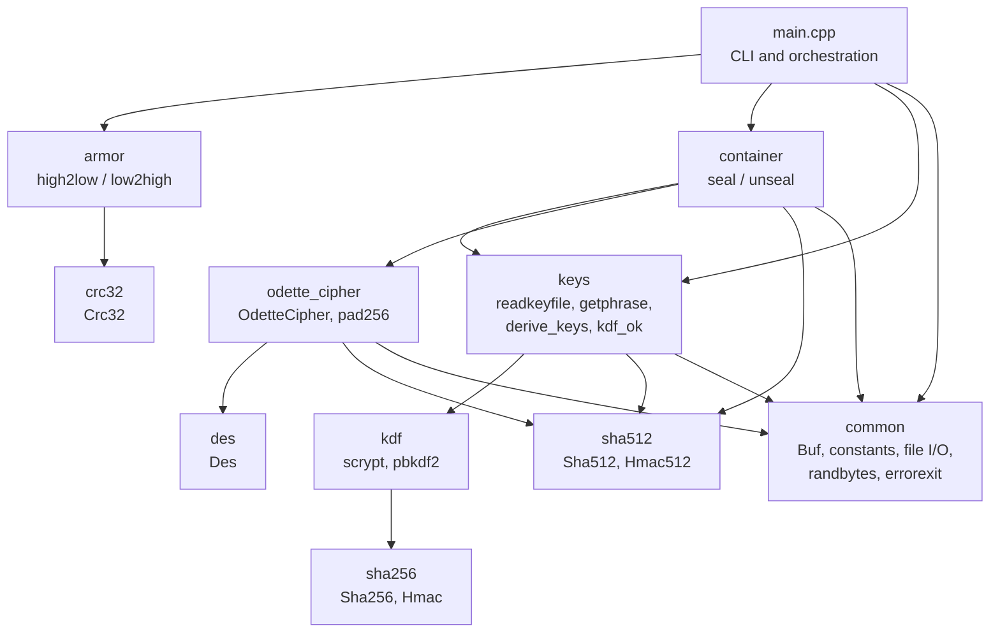
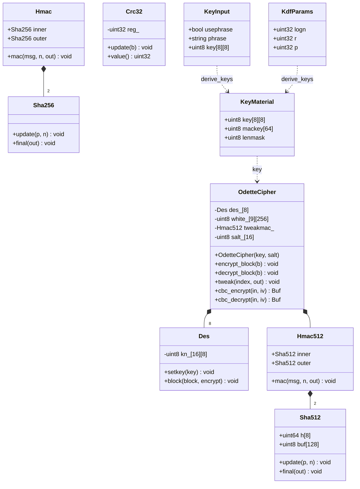
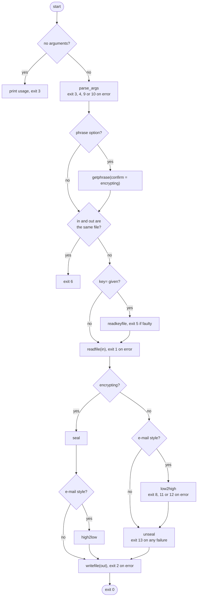
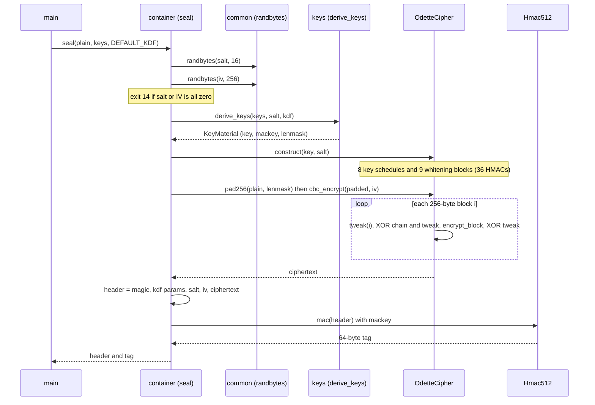
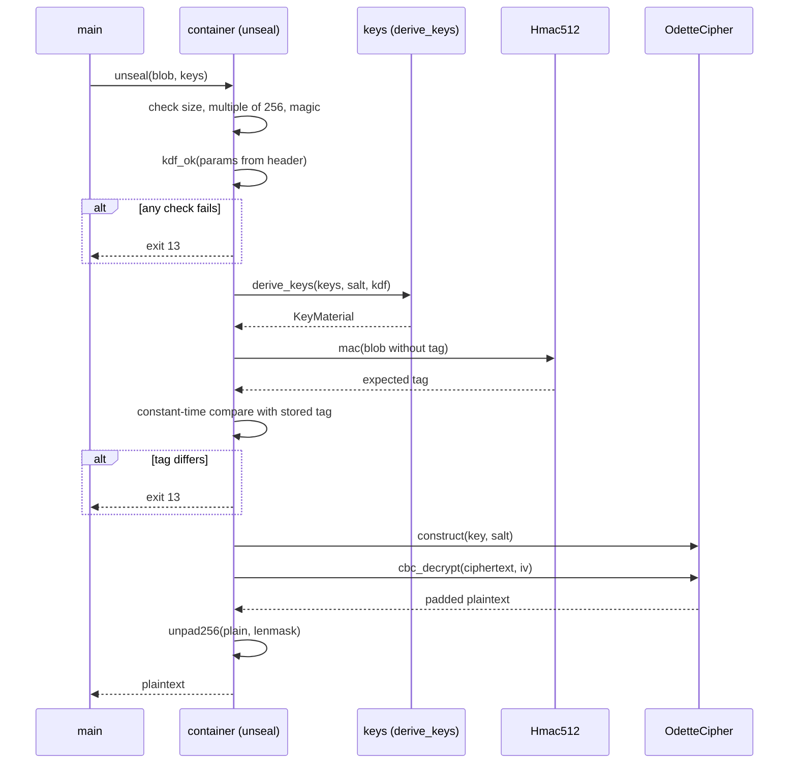
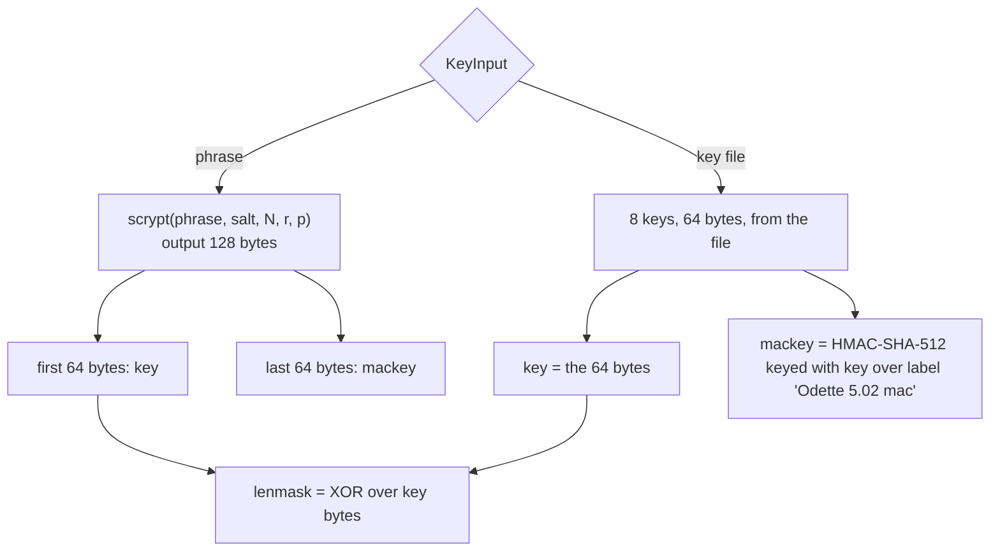
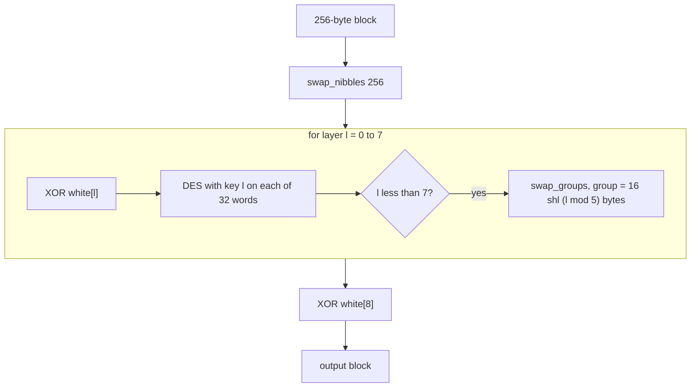
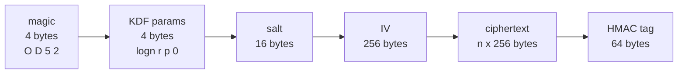
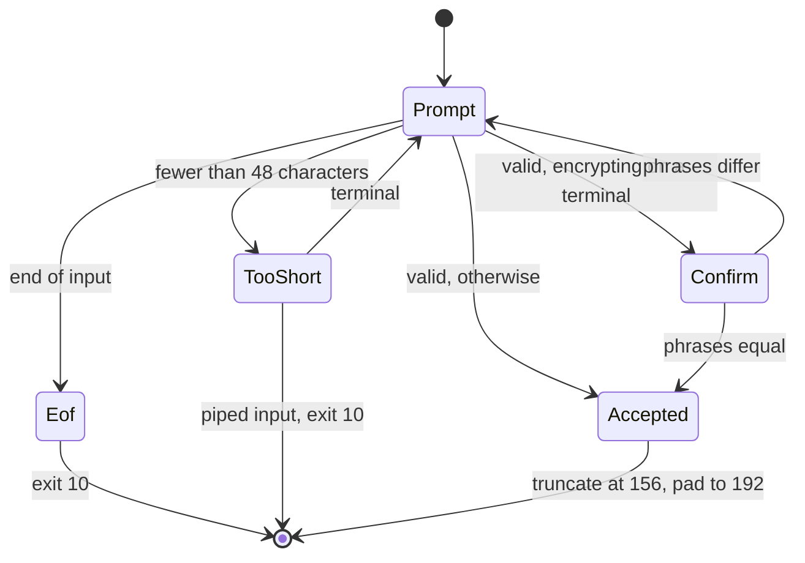
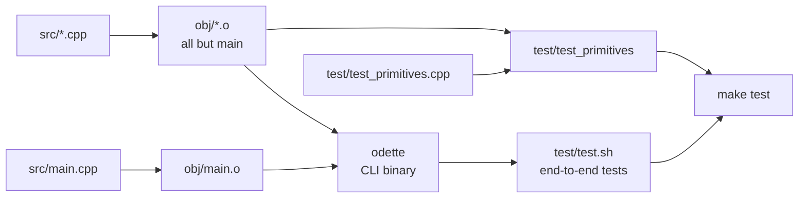

# Odette 5.02: software structure and flow

This document describes how the program is built and how data moves through it. For the cryptographic reasoning see [ANALYSIS.md](ANALYSIS.md); for usage see [README.md](README.md); for diagrams of one block passing through the cipher see [VISUALIZATION.md](VISUALIZATION.md).

## 1. Overview

Odette is a single-process command line tool written in C++ for Linux, with no third-party dependencies. It reads one input file completely into memory, transforms it, and writes one output file. There is no daemon, network access, or persistent state.

```
odette act=e|d|em|dm in=FILE out=FILE key=KEYFILE | phrase
```

| `act=` | Meaning | Steps |
|---|---|---|
| `e` | Encrypt, binary output | read, `seal`, write |
| `d` | Decrypt, binary input | read, `unseal`, write |
| `em` | Encrypt, e-mail text output | read, `seal`, `high2low`, write |
| `dm` | Decrypt, e-mail text input | read, `low2high`, `unseal`, write |

The code is split into small units, each with one job. Source files are in [src/](src/); the build is described in the [Makefile](Makefile).

| Unit | Files | Responsibility |
|---|---|---|
| Entry point | [main.cpp](src/main.cpp) | Argument parsing, orchestration, `bad_alloc` handling |
| Common | [common.h](src/common.h), [common.cpp](src/common.cpp) | `Buf` type, format constants, error exits, file I/O, random bytes |
| Keys | [keys.h](src/keys.h), [keys.cpp](src/keys.cpp) | Key file parser, phrase prompt, KDF parameter check, key derivation |
| Container | [container.h](src/container.h), [container.cpp](src/container.cpp) | `seal` and `unseal`: file format, MAC, order of operations |
| Cipher | [odette_cipher.h](src/odette_cipher.h), [odette_cipher.cpp](src/odette_cipher.cpp) | The 2048-bit wide-block cipher, tweak, CBC, padding |
| DES | [des.h](src/des.h), [des.cpp](src/des.cpp) | Single DES, used as the building block |
| Hashes | [sha256.h](src/sha256.h), [sha512.h](src/sha512.h) (+ `.cpp`) | SHA-256, SHA-512 and their HMACs |
| KDF | [kdf.h](src/kdf.h), [kdf.cpp](src/kdf.cpp) | PBKDF2-HMAC-SHA-256 and scrypt (RFC 7914) |
| Armor | [armor.h](src/armor.h), [armor.cpp](src/armor.cpp), [crc32.h](src/crc32.h), [crc32.cpp](src/crc32.cpp) | Binary to text conversion for e-mail, with CRC-32 |
| Tests | [test_primitives.cpp](test/test_primitives.cpp), [test.sh](test/test.sh) | Unit tests of primitives and end-to-end shell tests |

## 2. Layers and module dependencies

The program is layered. Higher layers call lower ones; nothing calls upward. `common` is used by almost everything and is omitted from some arrows below for readability.

In words: `main` drives everything. It asks `keys` for key input, `container` for sealing or unsealing, `armor` for text conversion, and `common` for file I/O. `container` combines `keys` (key derivation) with `odette_cipher` (encryption) and `sha512` (the MAC). `odette_cipher` uses `des` for the permutation layers and `sha512` (HMAC) to generate whitening and tweaks. `keys` uses `kdf` (scrypt) for phrases, and `kdf` uses `sha256`.



## 3. Class and data model

Most units are free functions; the stateful parts are small classes and structs.

In words: `OdetteCipher` is the central class. At construction it expands the eight DES keys (one `Des` each), computes nine 256-byte whitening blocks and stores an `Hmac512` object keyed with all key bytes, which is later used to compute the per-block tweak. `KeyInput` carries what the user supplied (a phrase or eight raw keys); `KeyMaterial` is what is left after derivation (cipher keys, MAC key and a length mask). `KdfParams` are the scrypt parameters, stored in the file header.



Free functions by unit:

| Unit | Functions |
|---|---|
| common | `readfile`, `writefile`, `randbytes`, `wipe`, `lockdown`, `errorexit`; global `errarg` names the file or argument the next error message refers to |
| keys | `readkeyfile`, `getphrase(confirm)`, `kdf_ok`, `derive_keys` |
| container | `seal`, `unseal` |
| odette_cipher | `pad256`, `unpad256` |
| kdf | `pbkdf2`, `scrypt` |
| armor | `high2low`, `low2high` |

## 4. Program flow

### 4.1 Top level

`main` first calls `lockdown`, which sets the core-file limit to zero and clears the dumpable flag, so a crash leaves no core file and other processes of the same user cannot attach a debugger or read the process memory. It then parses exactly four arguments (`act=`, `in=`, `out=`, and `key=` or `phrase`); any other count, a duplicate, an unknown option or a missing argument ends the program with an error code. It then obtains key input, rejects an input that is the same file as the output (by name and by device/inode), reads the input and runs the selected pipeline. Output is written last and only if everything before it succeeded.



Out-of-memory (`std::bad_alloc`) anywhere between reading and writing is caught in `main` and reported as error 7.

### 4.2 Encryption sequence

In words: `seal` draws a random 16-byte salt and a random 256-byte IV, derives the key material (for a phrase through scrypt; for a key file through one HMAC), builds the cipher, pads the plaintext to a multiple of 256 bytes, encrypts in CBC mode, assembles the header, ciphertext and finally appends an HMAC-SHA-512 tag over everything before it (encrypt-then-MAC).

The salt and the IV are drawn inside `seal` and nowhere else; no interface lets a caller supply them, and `seal` exits with error 14 if the random source fails or returns an all-zero value. This is an invariant of the design, not a convenience: the cipher's security argument needs every block to be encrypted by a permutation instance that is never used again, and the fresh salt is what separates the instances of one file from those of every other file (see [ANALYSIS.md](ANALYSIS.md), section 6.1).



### 4.3 Decryption sequence

In words: `unseal` first validates the size and magic number, then checks the KDF parameters against hard limits, because those bytes are not yet authenticated. It derives the keys, recomputes the HMAC over the whole file except the tag and compares it in constant time. Only if the tag matches does it decrypt. Every failure before decryption gives the same error 13, so an attacker learns nothing about which check failed.



## 5. The cipher in detail

### 5.1 Key derivation



The phrase is truncated at 156 characters (a warning is printed) and padded with spaces to 192 bytes. In key-file mode the salt does not feed key derivation but still feeds the whitening and tweaks, so two files made with the same key file share nothing.

### 5.2 One 256-byte block

`encrypt_block` applies a keyless nibble permutation first, then eight rounds of: XOR with a 256-byte whitening block, DES on each of the 32 eight-byte words with that layer's key, and a nibble swap whose group size cycles 16, 32, 64, 128, 256, 16, 32 bytes. A ninth whitening block is XORed at the end. The nibble swaps spread every bit across the whole 2048-bit block.



### 5.3 CBC with tweak

For block *i*: `work = plain[i] XOR previous_ciphertext XOR tweak(i)`, then `encrypt_block`, then `XOR tweak(i)`, giving ciphertext *i*. The first "previous" value is the random IV. The tweak is a 256-byte output of HMAC-SHA-512 keyed with all 64 key bytes, over a label, the salt and the block number, so every block uses its own permutation. Decryption reverses the steps and uses the previous ciphertext block as chain value.

### 5.4 Padding

`pad256` appends random bytes so the length becomes a multiple of 256, with at least one byte of padding. The last byte stores the number of real bytes in the final block (0 to 255) XORed with `lenmask`. `unpad256` is only called after authentication has succeeded.

## 6. File formats

### 6.1 Binary container



| Part | Size | Notes |
|---|---|---|
| Header | 280 bytes | magic (4), KDF params (4), salt (16), IV (256) |
| Ciphertext | multiple of 256, at least 256 | CBC output |
| Tag | 64 bytes | HMAC-SHA-512 over header and ciphertext |

The smallest possible container is 600 bytes. The KDF parameters are validated by `kdf_ok` before use: `logn` 4 to 20, `r` 1 to 16, `p` 1 to 4, and at most 256 MiB of scrypt memory. The default written by `seal` is `logn=17, r=8, p=1` (128 MiB).

### 6.2 E-mail (armored) format

`high2low` appends a `0xFF` end marker, encodes the bytes with a 64-character alphabet (`0-9 : ;`, `A-Z`, `a-z`), inserts a newline at regular intervals, and wraps the result in a `*BEGIN Odette 5.02 message, valid char: N` line (N is the count of encoded characters) and a `*END Odette 5.02 message, CRC: C` line. `low2high` scans for the BEGIN line, decodes exactly N valid characters while ignoring everything else (whitespace, line breaks, quoting damage), finds the END line, checks the CRC-32 and removes the end marker. The CRC only catches transmission damage; authenticity comes from the HMAC checked afterwards in `unseal`.

## 7. Phrase input



Echo is switched off on a terminal. Piped input is read once and never confirmed.

## 8. Error handling

All failures end in `errorexit(code)`, which prints a message to stderr and calls `exit(code)`; there are no exceptions in normal control flow (only `bad_alloc` is caught in `main`). The global `errarg` carries the file name or argument for the message. Key-file errors name only the file.

| Code | Raised by | Meaning |
|---|---|---|
| 1 | `readfile`, `readkeyfile` | cannot read (open failure, directory, read error) |
| 2 | `writefile` | cannot write (also refuses symlinks; files are created with mode 0600) |
| 3, 4, 9, 10 | `parse_args`, `getphrase` | wrong count, invalid, duplicate or missing argument |
| 5 | `readkeyfile` | faulty key file |
| 6 | `main` | input and output are the same file |
| 7 | scrypt, `main` | out of memory |
| 8, 11, 12 | `low2high` | no BEGIN line, no END line or short body, CRC mismatch |
| 13 | `unseal` | authentication failed, bad header, wrong key or altered data |
| 14 | `randbytes`, `seal` | system random generator failed or returned an all-zero salt or IV |

## 9. Build and test structure

The Makefile compiles every `src/*.cpp` except `main.cpp` into `obj/*.o` (with automatic header dependencies), links `main.o` plus those objects into `odette`, and links the same objects with `test/test_primitives.cpp` into a unit test binary.



- `test_primitives` checks SHA-256, SHA-512, HMAC (RFC 4231), PBKDF2 and scrypt (RFC 7914) against published vectors, and checks cipher properties: equal blocks give unrelated ciphertext, every key bit matters, salt and block index change the tweak, one changed input bit or word changes every output word in both directions, eight identical DES keys still give distinct layers, and two `seal` calls on the same input share neither salt, IV nor ciphertext.
- `test.sh` runs the real binary: round trips in all four modes for several sizes, phrase mode, wrong-key and corrupted-input failures, truncation and block-edit detection, rejection of files of another version, fresh salt per encryption, and container size.

## 10. Design notes for maintainers

- **Order of operations is security-relevant.** Encrypt-then-MAC, with the MAC verified before any decryption or unpadding. Header fields are untrusted until the tag is verified, so they are bounded by `kdf_ok`.
- **File format.** The on-disk format is defined by `HDR_LEN`, `MAGIC` and the label strings `"Odette 5.02 white"`, `"... tweak"` and `"... mac"`; changing any of them breaks existing files.
- **Randomisation is mandatory.** Salt and IV are drawn in `seal` only. Do not add a deterministic mode or a caller-supplied salt or IV; see section 4.2 and [ANALYSIS.md](ANALYSIS.md), section 10.
- **Memory model.** Whole files are held in memory, and sealing keeps several copies (padded input, ciphertext, output). scrypt allocates 128 MiB in phrase mode.
- **No global state** other than `errarg` and the immutable DES lookup tables built at startup.
- **Secrets are wiped.** `KeyInput`, `KeyMaterial`, `Des`, `OdetteCipher`, `Sha256` and `Sha512` zeroise their key material, schedules, whitening and HMAC pad states in their destructors with `explicit_bzero`; the key-file parser, the phrase confirmation copy and the scrypt and PBKDF2 intermediates (including the 128 MiB table) are wiped before they go out of scope. Plaintext and ciphertext buffers are not wiped: they are the user's own data and live in ordinary `Buf` objects. Keep new code holding key material inside one of these types, or wipe it explicitly.
