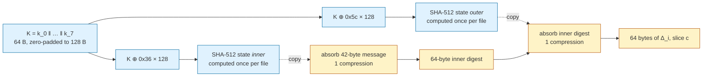
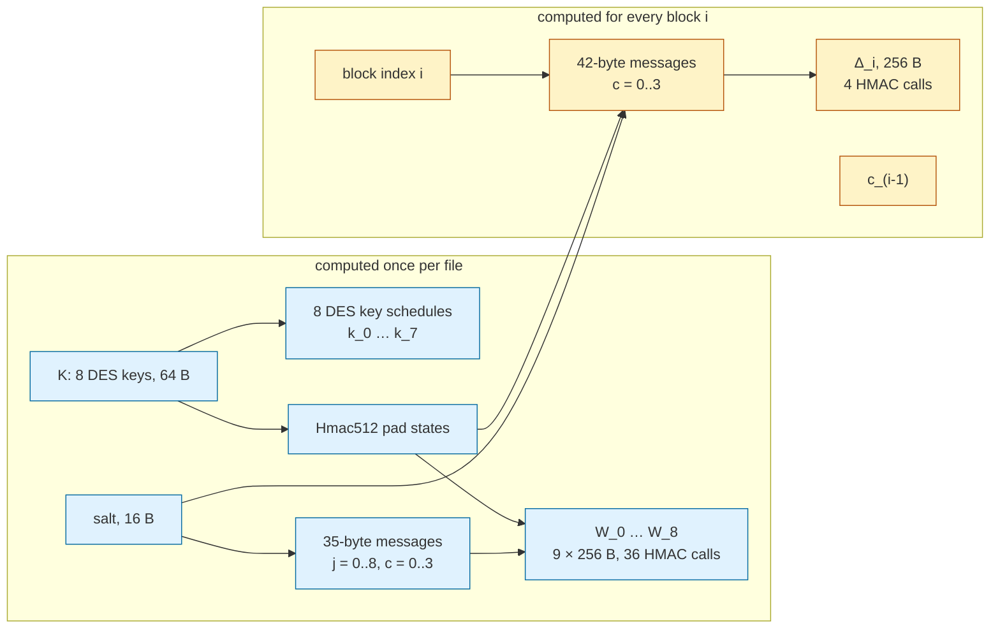
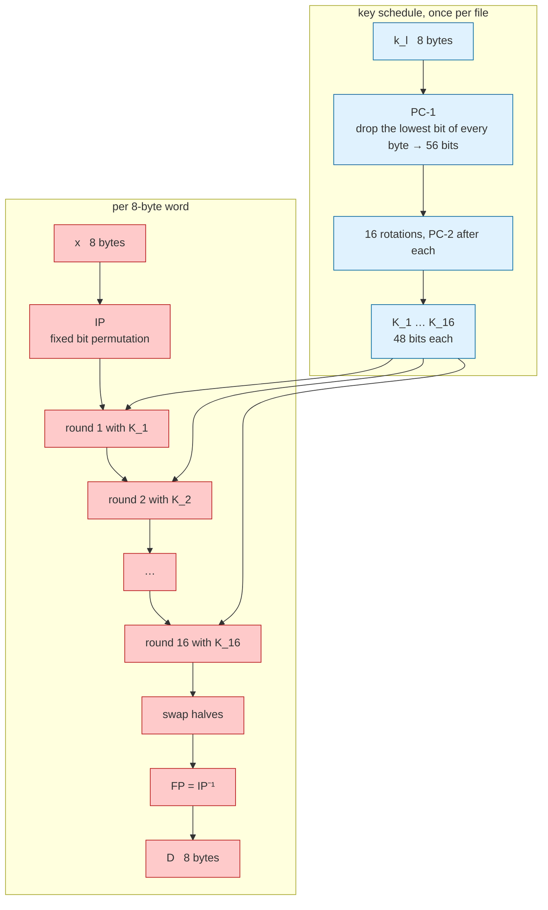

# Odette 5.02 in pictures: one block, layer by layer

This document draws what happens to a single 256-byte block on its way from plaintext to ciphertext. It shows *where* every byte comes from and *where* it goes; the reasons why the construction is built this way are in [ANALYSIS.md](ANALYSIS.md), and the code that does it is described in [STRUCTURE.md](STRUCTURE.md). Only encryption is drawn: decryption is the same ladder climbed downwards. All positions and offsets were read from [src/odette_cipher.cpp](src/odette_cipher.cpp).

In one line, for block number $i$:

```
c_i  =  Δ_i ⊕ W_8 ⊕ DES_k7( W_7 ⊕ P( … P( DES_k0( W_0 ⊕ P256( m_i ⊕ c_(i-1) ⊕ Δ_i ) ) ) … ) )
```

Everything below unpacks that line.

## 0. Vocabulary and glyphs

| Term | Meaning in this document |
|---|---|
| **block** | 256 bytes = 2048 bits, the unit the whole cipher works on |
| **word** | 8 consecutive bytes of a block; the unit DES works on; there are 32, numbered 0..31 |
| **lane** | the position of a byte inside its word, 0..7; no step of the cipher ever changes a byte's lane |
| **nibble** | half a byte; the high nibble is bits 7..4, the low nibble bits 3..0 |
| **group** | the span of bytes one permutation step works on: 16, 32, 64, 128 or 256 bytes |
| **stride** | the distance, in words, between two words that exchange nibbles: half a group |
| **layer** | one `⊕ W_l`, one DES pass over all 32 words, and (except after the last) one permutation |

Glyphs used in the byte maps:

```
m   plaintext byte              W   whitening byte  (fixed for the whole file)
c   chaining byte               Δ   tweak byte      (fixed for this block only)
    (previous ciphertext,       D   DES output byte
     or IV for block 0)         L/H low / high nibble
```

## 1. Where block $i$ sits in the file

```
offset  0      4      8        24                280
        ┌──────┬──────┬────────┬─────────────────┬─────────┬─────────┬───┬─────────┬─────────┐
        │ O D  │ logN │  salt  │       IV        │   c_0   │   c_1   │ … │   c_n   │   tag   │
        │ 5 2  │ r p 0│  16 B  │     256 B       │  256 B  │  256 B  │   │  256 B  │  64 B   │
        └──────┴──────┴────────┴─────────────────┴─────────┴─────────┴───┴─────────┴─────────┘
                        │             │                        ▲
                        │             └── chain value c_(-1) ──┘  (c_(i-1) for block i)
                        └── feeds every W_j and every Δ_i
```

Two header fields reach into the cipher: the **salt** is part of every HMAC message that produces whitening and tweaks, and the **IV** is the chain value of block 0. Block $i$ is encrypted after block $i-1$ because it needs $c_{i-1}$.

## 2. The block as a grid of words and lanes

A block is best pictured as 32 rows (words) of 8 columns (lanes). The word index is written in binary because every permutation step flips exactly one of those five bits.

```
word  index   lane: 0    1    2    3    4    5    6    7     HMAC slice c
 0    00000       0    1    2    3    4    5    6    7     ┐
 1    00001       8    9   10   11   12   13   14   15     │
 2    00010      16   17   18   19   20   21   22   23     │
 3    00011      24   25   26   27   28   29   30   31     │  c = 0
 4    00100      32   33   34   35   36   37   38   39     │  bytes 0..63
 5    00101      40   41   42   43   44   45   46   47     │
 6    00110      48   49   50   51   52   53   54   55     │
 7    00111      56   57   58   59   60   61   62   63     ┘
 8    01000      64   65   66   67   68   69   70   71     ┐
 9    01001      72   73   74   75   76   77   78   79     │
10    01010      80   81   82   83   84   85   86   87     │
11    01011      88   89   90   91   92   93   94   95     │  c = 1
12    01100      96   97   98   99  100  101  102  103     │  bytes 64..127
13    01101     104  105  106  107  108  109  110  111     │
14    01110     112  113  114  115  116  117  118  119     │
15    01111     120  121  122  123  124  125  126  127     ┘
16    10000     128  129  130  131  132  133  134  135     ┐
17    10001     136  137  138  139  140  141  142  143     │
18    10010     144  145  146  147  148  149  150  151     │
19    10011     152  153  154  155  156  157  158  159     │  c = 2
20    10100     160  161  162  163  164  165  166  167     │  bytes 128..191
21    10101     168  169  170  171  172  173  174  175     │
22    10110     176  177  178  179  180  181  182  183     │
23    10111     184  185  186  187  188  189  190  191     ┘
24    11000     192  193  194  195  196  197  198  199     ┐
25    11001     200  201  202  203  204  205  206  207     │
26    11010     208  209  210  211  212  213  214  215     │
27    11011     216  217  218  219  220  221  222  223     │  c = 3
28    11100     224  225  226  227  228  229  230  231     │  bytes 192..255
29    11101     232  233  234  235  236  237  238  239     │
30    11110     240  241  242  243  244  245  246  247     │
31    11111     248  249  250  251  252  253  254  255     ┘
```

Three things act on this grid, and each respects it differently:

| Step | Touches | Crosses words? | Crosses lanes? |
|---|---|---|---|
| `⊕ W_l`, `⊕ Δ_i`, `⊕ c_(i-1)` | every byte, position for position | no | no |
| DES with $k_l$ | one word at a time, all 8 lanes of it | no | yes, inside the word |
| $P_s$ (nibble swap) | one nibble of every byte | **yes**, to the partner word | no |

The permutation is therefore the only step that moves information between words, and it moves it only sideways, never to another lane.

## 3. The tweak $\Delta_i$

### 3.1 How 256 tweak bytes are made

Four HMAC-SHA-512 calls, each 64 bytes of output, fill the four 64-byte slices shown in the grid above. The messages differ only in the last byte.

```
HMAC message for Δ_i, slice c            (42 bytes)

offset    0                     17               33                             41
         ┌─────────────────────┬─────────────────┬───────────────────────────────┬───┐
         │ "Odette 5.02 tweak" │ salt            │ block index i                 │ c │
         │ 17 bytes            │ 16 bytes        │ 8 bytes, big-endian           │ 1 │
         └─────────────────────┴─────────────────┴───────────────────────────────┴───┘
                                                                                 c = 0, 1, 2, 3

Δ_i  bytes    0 ………… 63  │  64 ………… 127  │  128 ………… 191  │  192 ………… 255
              HMAC c = 0 │  HMAC c = 1   │  HMAC c = 2    │  HMAC c = 3
words         0 … 7      │  8 … 15       │  16 … 23       │  24 … 31
```

The HMAC key is the full 64-byte key $K = k_0\|k_1\|\cdots\|k_7$. SHA-512 has a 128-byte block, so $K$ is zero-padded, XORed with the two HMAC pad constants and absorbed once at construction time; each tweak call starts from a copy of those two states. A 42-byte message plus padding fits one SHA-512 block, and so does the 64-byte inner digest, so one call is exactly two compressions.



Blue is done once per file, amber four times per block.

### 3.2 Where the tweak bytes land

The same 256 bytes are used twice: once mixed into the input together with the plaintext and the chain value, once XORed onto the output of the core. Byte $n$ of $\Delta_i$ always meets byte $n$ of the state; nothing is shifted.

```
            byte  0   1   2   3   4   5   6   7   8  …  255
plaintext         m   m   m   m   m   m   m   m   m  …   m      m_i (padded)
chain value       c   c   c   c   c   c   c   c   c  …   c      c_(i-1), or IV when i = 0
tweak             Δ   Δ   Δ   Δ   Δ   Δ   Δ   Δ   Δ  …   Δ      Δ_i, slice 0 for bytes 0..63
                  ───────────────────────────────────────
core input        ⊕   ⊕   ⊕   ⊕   ⊕   ⊕   ⊕   ⊕   ⊕  …   ⊕      m ⊕ c ⊕ Δ at every byte
                  │   │   │   │   │   │   │   │   │       │
                  ▼   ▼   ▼   ▼   ▼   ▼   ▼   ▼   ▼       ▼
             ╔═══════════════════════════════════════════════╗
             ║  P256, 8 × [ ⊕ W_l, 32 × DES k_l, P_s ], ⊕ W_8 ║   the core (section 6)
             ╚═══════════════════════════════════════════════╝
                  │   │   │   │   │   │   │   │   │       │
tweak again       Δ   Δ   Δ   Δ   Δ   Δ   Δ   Δ   Δ  …   Δ      the same Δ_i
                  ───────────────────────────────────────
ciphertext        c   c   c   c   c   c   c   c   c  …   c      c_i, also the chain value of block i+1
```

Because the mask sits on both sides, the pair $(\Delta_i, \Delta_i)$ turns the one core permutation into a different permutation for every block index; a block's own $\Delta_i$ never appears anywhere else in the file, and the salt in the message means it never appears in any other file either.

### 3.3 What is fixed per file and what changes per block



## 4. The whitening $W_0 \dots W_8$

The whitening is made exactly like the tweak, with two differences: a one-byte layer number $j$ replaces the eight-byte block index, and the label says `white`. Thirty-six calls fill nine 256-byte masks, once per file.

```
HMAC message for W_j, slice c            (35 bytes)

offset    0                     17               33   34
         ┌─────────────────────┬─────────────────┬─────┬───┐
         │ "Odette 5.02 white" │ salt            │  j  │ c │
         │ 17 bytes            │ 16 bytes        │  1  │ 1 │
         └─────────────────────┴─────────────────┴─────┴───┘

                  slice c = 0      c = 1       c = 2       c = 3
                  words 0..7      8..15      16..23      24..31
W_0   (j = 0)    [ call  1 ]  [ call  2 ]  [ call  3 ]  [ call  4 ]   XORed before DES k_0
W_1   (j = 1)    [ call  5 ]  [ call  6 ]  [ call  7 ]  [ call  8 ]   before DES k_1
W_2   (j = 2)    [ call  9 ]  [ call 10 ]  [ call 11 ]  [ call 12 ]   before DES k_2
W_3   (j = 3)    [ call 13 ]  [ call 14 ]  [ call 15 ]  [ call 16 ]   before DES k_3
W_4   (j = 4)    [ call 17 ]  [ call 18 ]  [ call 19 ]  [ call 20 ]   before DES k_4
W_5   (j = 5)    [ call 21 ]  [ call 22 ]  [ call 23 ]  [ call 24 ]   before DES k_5
W_6   (j = 6)    [ call 25 ]  [ call 26 ]  [ call 27 ]  [ call 28 ]   before DES k_6
W_7   (j = 7)    [ call 29 ]  [ call 30 ]  [ call 31 ]  [ call 32 ]   before DES k_7
W_8   (j = 8)    [ call 33 ]  [ call 34 ]  [ call 35 ]  [ call 36 ]   after  DES k_7
```

Nine masks for eight DES layers: every DES pass is preceded by a mask, and the last one is also followed by one. Seen as a stack:

```
           Δ_i   ──┐
                   ├── input side
           W_0   ──┘
        DES k_0
           W_1
        DES k_1
           W_2
        DES k_2
           W_3
        DES k_3
           W_4
        DES k_4
           W_5
        DES k_5
           W_6
        DES k_6
           W_7
        DES k_7
           W_8   ──┐
                   ├── output side
           Δ_i   ──┘
```

Two details worth seeing in the picture: the DES passes read 56 bits of each $k_l$ (DES skips the lowest bit of every key byte), but the HMAC reads all 64 bytes of $K$, so the eight skipped bits still shape every $W_j$ and every $\Delta_i$. And the whitening bytes are positional like the tweak: byte $(w, \text{lane})$ of $W_l$ meets byte $(w, \text{lane})$ of the state.

## 5. The nibble swap $P_s$

### 5.1 Two bytes at a time

`swap_nibbles` works on a span of $s$ bytes and pairs byte $i$ in the lower half with byte $j = i + s/2$ in the upper half. Each byte keeps one nibble and receives one from its partner:

```
         before                              after
   byte i (lower half)   [ hi_i | lo_i ]      [ lo_j | lo_i ]     keeps its LOW nibble,
                                                                  high slot filled with partner's low nibble
   byte j (upper half)   [ hi_j | lo_j ]      [ hi_j | hi_i ]     keeps its HIGH nibble,
                                                                  low slot filled with partner's high nibble

                         hi_i ──────────────────────▶ low slot of j
                         lo_j ──────────────────────▶ high slot of i
```

Because $s/2$ is always a multiple of 8, byte $i$ and byte $j$ are in the same lane of two different words. For a whole word pair, with lanes across:

```
                lane:   0    1    2    3    4    5    6    7
word b          high:  a0   a1   a2   a3   a4   a5   a6   a7   ──┐  all eight move to word b⊕stride, low slots
(lower half)    low :  b0   b1   b2   b3   b4   b5   b6   b7     │  stay
                                                                  │
word b⊕stride   high:  q0   q1   q2   q3   q4   q5   q6   q7     │  stay
(upper half)    low :  p0   p1   p2   p3   p4   p5   p6   p7   ──┘  all eight move to word b, high slots

after:
word b          high:  p0   p1   p2   p3   p4   p5   p6   p7
                low :  b0   b1   b2   b3   b4   b5   b6   b7
word b⊕stride   high:  q0   q1   q2   q3   q4   q5   q6   q7
                low :  a0   a1   a2   a3   a4   a5   a6   a7
```

So every word hands exactly 32 of its 64 bits to one partner and gets 32 back. Applying the same swap twice restores the original, which is why decryption can reuse it unchanged.

### 5.2 Which word partners which

`swap_groups` tiles the block with groups of $s$ bytes and runs the two-byte swap in each. The stride is $s/16$ words, and the partner of word $b$ is $b \oplus \text{stride}$: one bit of the word index is flipped. The row `keeps` says which nibbles of a word stay put (L: low, H: high).

```
word      |  0  1  2  3  4  5  6  7  8  9 10 11 12 13 14 15 16 17 18 19 20 21 22 23 24 25 26 27 28 29 30 31

P16   pair|  1  0  3  2  5  4  7  6  9  8 11 10 13 12 15 14 17 16 19 18 21 20 23 22 25 24 27 26 29 28 31 30
stride 1  |
bit 0 keep|  L  H  L  H  L  H  L  H  L  H  L  H  L  H  L  H  L  H  L  H  L  H  L  H  L  H  L  H  L  H  L  H

P32   pair|  2  3  0  1  6  7  4  5 10 11  8  9 14 15 12 13 18 19 16 17 22 23 20 21 26 27 24 25 30 31 28 29
stride 2  |
bit 1 keep|  L  L  H  H  L  L  H  H  L  L  H  H  L  L  H  H  L  L  H  H  L  L  H  H  L  L  H  H  L  L  H  H

P64   pair|  4  5  6  7  0  1  2  3 12 13 14 15  8  9 10 11 20 21 22 23 16 17 18 19 28 29 30 31 24 25 26 27
stride 4  |
bit 2 keep|  L  L  L  L  H  H  H  H  L  L  L  L  H  H  H  H  L  L  L  L  H  H  H  H  L  L  L  L  H  H  H  H

P128  pair|  8  9 10 11 12 13 14 15  0  1  2  3  4  5  6  7 24 25 26 27 28 29 30 31 16 17 18 19 20 21 22 23
stride 8  |
bit 3 keep|  L  L  L  L  L  L  L  L  H  H  H  H  H  H  H  H  L  L  L  L  L  L  L  L  H  H  H  H  H  H  H  H

P256  pair| 16 17 18 19 20 21 22 23 24 25 26 27 28 29 30 31  0  1  2  3  4  5  6  7  8  9 10 11 12 13 14 15
stride 16 |
bit 4 keep|  L  L  L  L  L  L  L  L  L  L  L  L  L  L  L  L  H  H  H  H  H  H  H  H  H  H  H  H  H  H  H  H
```

### 5.3 The order in which the strides are used

The group size is $16 \ll (l \bmod 5)$ bytes after layer $l$, and a $P_{256}$ comes first. Read as index bits, the first five swaps touch bits 4, 0, 1, 2, 3 and the next three start the cycle again:

```
position     before   after    after    after    after    after    after    after    after
             DES k_0  DES k_0  DES k_1  DES k_2  DES k_3  DES k_4  DES k_5  DES k_6  DES k_7
swap         P256     P16      P32      P64      P128     P256     P16      P32      (none)
stride       16       1        2        4        8        16       1        2
index bit    4        0        1        2        3        4        0        1
```

Flipping each of the five bits once is enough to connect any word with any other, which is what section 7 shows happening.

## 6. One block through all layers

### 6.1 The full ladder

Colours: yellow for whitening XORs, red for DES, green for nibble swaps, blue for the tweak and chain.

```mermaid
flowchart TD
    m["m_i<br/>plaintext block, 256 B"]
    cp["c_(i-1)<br/>previous ciphertext block<br/>(IV for i = 0)"]
    t1["Δ_i<br/>tweak, 256 B"]
    X0(("⊕"))
    P0["P256 &nbsp; stride 16 &nbsp; flips bit 4"]

    subgraph L0["layer 0"]
        W0["⊕ W_0"] --> D0["DES k_0 on each of 32 words"] --> S0["P16 &nbsp; stride 1 &nbsp; bit 0"]
    end
    subgraph L1["layer 1"]
        W1["⊕ W_1"] --> D1["DES k_1 on each of 32 words"] --> S1["P32 &nbsp; stride 2 &nbsp; bit 1"]
    end
    subgraph L2["layer 2"]
        W2["⊕ W_2"] --> D2["DES k_2 on each of 32 words"] --> S2["P64 &nbsp; stride 4 &nbsp; bit 2"]
    end
    subgraph L3["layer 3"]
        W3["⊕ W_3"] --> D3["DES k_3 on each of 32 words"] --> S3["P128 &nbsp; stride 8 &nbsp; bit 3"]
    end
    subgraph L4["layer 4"]
        W4["⊕ W_4"] --> D4["DES k_4 on each of 32 words"] --> S4["P256 &nbsp; stride 16 &nbsp; bit 4"]
    end
    subgraph L5["layer 5"]
        W5["⊕ W_5"] --> D5["DES k_5 on each of 32 words"] --> S5["P16 &nbsp; stride 1 &nbsp; bit 0"]
    end
    subgraph L6["layer 6"]
        W6["⊕ W_6"] --> D6["DES k_6 on each of 32 words"] --> S6["P32 &nbsp; stride 2 &nbsp; bit 1"]
    end
    subgraph L7["layer 7"]
        W7["⊕ W_7"] --> D7["DES k_7 on each of 32 words"]
    end

    W8["⊕ W_8"]
    X1(("⊕"))
    t2["Δ_i<br/>the same tweak"]
    ci["c_i<br/>ciphertext block, 256 B"]
    nx["chain value for block i+1"]

    m --> X0
    cp --> X0
    t1 --> X0
    X0 --> P0 --> W0
    S0 --> W1
    S1 --> W2
    S2 --> W3
    S3 --> W4
    S4 --> W5
    S5 --> W6
    S6 --> W7
    D7 --> W8 --> X1
    t2 --> X1
    X1 --> ci
    ci -.-> nx

    classDef white fill:#fef08a,stroke:#a16207
    classDef des fill:#fecaca,stroke:#b91c1c
    classDef perm fill:#bbf7d0,stroke:#15803d
    classDef tweak fill:#bfdbfe,stroke:#1d4ed8
    class W0,W1,W2,W3,W4,W5,W6,W7,W8 white
    class D0,D1,D2,D3,D4,D5,D6,D7 des
    class P0,S0,S1,S2,S3,S4,S5,S6 perm
    class m,cp,t1,t2,X0,X1,ci,nx tweak
```



Twenty-five operations separate the core's input from its output: one $P_{256}$, nine whitening XORs, eight DES passes and seven swaps. The two tweak XORs sit outside that, and the chain XOR is folded into the first of them.

### 6.2 One layer, close up

Take one word $w$ of the state as it enters layer $l$. The whitening byte and the DES input line up lane by lane; the DES output does not: every output byte depends on all eight input bytes and on the 56 key bits.

```
                        lane:   0    1    2    3    4    5    6    7
state entering layer l          s    s    s    s    s    s    s    s     s = result of the previous swap
whitening W_l, word w     ⊕     W    W    W    W    W    W    W    W     byte 8w+lane of W_l
                                ────────────────────────────────────
DES input                       x    x    x    x    x    x    x    x     x = s ⊕ W, lane by lane
                                ╰────────────── DES k_l ──────────────╯  one 64-bit encryption
DES output                      D    D    D    D    D    D    D    D     every D depends on all eight x
                                                                          and on k_l; nothing lines up any more
P_s on word w             keeps one nibble of every D, sends the other nibble, lane by lane, to word w ⊕ stride
```

Seen across the block, for layer 0 (stride 1: neighbours exchange nibbles) and layer 4 (stride 16: the two halves of the block exchange nibbles). Each `[DES]` is one 64-bit encryption of one word; each `W` is the 8-byte strip of the mask that lies on that word.

```
layer 0, words 0..15 (words 16..31 look the same)
word         0    1    2    3    4    5    6    7    8    9   10   11   12   13   14   15
⊕ W_0        W    W    W    W    W    W    W    W    W    W    W    W    W    W    W    W
DES k_0    [DES][DES][DES][DES][DES][DES][DES][DES][DES][DES][DES][DES][DES][DES][DES][DES]
P16        ╰───┬───╯ ╰───┬───╯ ╰───┬───╯ ╰───┬───╯ ╰───┬───╯ ╰───┬───╯ ╰───┬───╯ ╰───┬───╯    stride 1: 0↔1, 2↔3, …, 14↔15

layer 4, all 32 words drawn as two rows of 16
word         0    1    2    3    4    5    6    7    8    9   10   11   12   13   14   15
⊕ W_4        W    W    W    W    W    W    W    W    W    W    W    W    W    W    W    W
DES k_4    [DES][DES][DES][DES][DES][DES][DES][DES][DES][DES][DES][DES][DES][DES][DES][DES]
P256         ↕    ↕    ↕    ↕    ↕    ↕    ↕    ↕    ↕    ↕    ↕    ↕    ↕    ↕    ↕    ↕      stride 16: 0↔16, 1↔17, …, 15↔31
DES k_4    [DES][DES][DES][DES][DES][DES][DES][DES][DES][DES][DES][DES][DES][DES][DES][DES]
⊕ W_4        W    W    W    W    W    W    W    W    W    W    W    W    W    W    W    W
word        16   17   18   19   20   21   22   23   24   25   26   27   28   29   30   31
```

### 6.3 What a byte is made of, step by step

Following one position $(w, n)$ (word $w$, lane $n$) down the ladder, this is what the byte there is a function of. Each DES pass resets the picture to "everything in this word".

| After | Byte at $(w, n)$ depends on |
|---|---|
| input XOR | $m_i$, $c_{i-1}$ and $\Delta_i$ at the same position $(w, n)$ |
| $P_{256}$ | one nibble from $(w, n)$ and one nibble from $(w \oplus 16, n)$ |
| $\oplus W_0$ | the above, plus $W_0[8w + n]$ |
| DES $k_0$ | all eight bytes of word $w$ as they entered DES, and $k_0$ |
| $P_{16}$ | one nibble each of word $w$ and word $w \oplus 1$, both DES outputs |
| $\oplus W_1$, DES $k_1$ | all of word $w$: which, through the swap, means half of two DES-$k_0$ outputs |
| … | each swap adds a partner, each DES pass merges the word |
| DES $k_7$ | all of word $w$ at the input of layer 7 |
| $\oplus W_8$ | the above, plus $W_8[8w + n]$ |
| $\oplus \Delta_i$ | the above, plus $\Delta_i[8w + n]$; this is $c_i[8w + n]$ |

The whitening and tweak bytes are always *added at the same position*; the DES bytes are always *replaced by a function of their whole word*; the swap bytes are always *half local, half from the partner*.

## 7. Following one plaintext byte

Start with byte 0 of the block (word 0, lane 0) and ask which words know anything about it as the layers go by. The two nibbles part ways immediately: $P_{256}$ keeps the low nibble in word 0 and sends the high nibble to word 16. From then on every DES pass turns "a nibble, or half the bits, in this word" into "all 64 bits of this word", and every swap hands half of each reached word to one new partner.

```
word                  0  1  2  3  4  5  6  7  8  9 10 11 12 13 14 15 16 17 18 19 20 21 22 23 24 25 26 27 28 29 30 31
input ⊕ c ⊕ Δ         B  .  .  .  .  .  .  .  .  .  .  .  .  .  .  .  .  .  .  .  .  .  .  .  .  .  .  .  .  .  .  .   1 byte
P256   (bit 4)        L  .  .  .  .  .  .  .  .  .  .  .  .  .  .  .  H  .  .  .  .  .  .  .  .  .  .  .  .  .  .  .   2 words, 1 nibble each
⊕ W_0, DES k_0        #  .  .  .  .  .  .  .  .  .  .  .  .  .  .  .  #  .  .  .  .  .  .  .  .  .  .  .  .  .  .  .   2 words, all bits
P16    (bit 0)        h  h  .  .  .  .  .  .  .  .  .  .  .  .  .  .  h  h  .  .  .  .  .  .  .  .  .  .  .  .  .  .   4 words, half each
⊕ W_1, DES k_1        #  #  .  .  .  .  .  .  .  .  .  .  .  .  .  .  #  #  .  .  .  .  .  .  .  .  .  .  .  .  .  .   4 words, all bits
P32    (bit 1)        h  h  h  h  .  .  .  .  .  .  .  .  .  .  .  .  h  h  h  h  .  .  .  .  .  .  .  .  .  .  .  .   8 half
⊕ W_2, DES k_2        #  #  #  #  .  .  .  .  .  .  .  .  .  .  .  .  #  #  #  #  .  .  .  .  .  .  .  .  .  .  .  .   8 full
P64    (bit 2)        h  h  h  h  h  h  h  h  .  .  .  .  .  .  .  .  h  h  h  h  h  h  h  h  .  .  .  .  .  .  .  .  16 half
⊕ W_3, DES k_3        #  #  #  #  #  #  #  #  .  .  .  .  .  .  .  .  #  #  #  #  #  #  #  #  .  .  .  .  .  .  .  .  16 full
P128   (bit 3)        h  h  h  h  h  h  h  h  h  h  h  h  h  h  h  h  h  h  h  h  h  h  h  h  h  h  h  h  h  h  h  h  32 half
⊕ W_4, DES k_4        #  #  #  #  #  #  #  #  #  #  #  #  #  #  #  #  #  #  #  #  #  #  #  #  #  #  #  #  #  #  #  #  32 full
P256   (bit 4)        #  #  #  #  #  #  #  #  #  #  #  #  #  #  #  #  #  #  #  #  #  #  #  #  #  #  #  #  #  #  #  #  both partners full
⊕ W_5 … DES k_7       #  #  #  #  #  #  #  #  #  #  #  #  #  #  #  #  #  #  #  #  #  #  #  #  #  #  #  #  #  #  #  #  stays full

  B  the byte itself     L / H  only its low / high nibble     h  32 of the word's 64 bit positions     #  the whole word
```

Reading the right-hand column: 2, 4, 8, 16, 32 words. Five swaps with five different index bits reach every word: all 32 are touched when the state enters layer 4 and all 2048 bits depend on the byte when it leaves; layers 5 to 7 add margin. The same table for a single *bit* instead of a byte runs one step behind (1, 2, 4, 8, 16, 32), because a bit lives in one nibble and so starts in one word, which is the sequence measured in [ANALYSIS.md](ANALYSIS.md), section 4. Starting from any other byte gives the same table with the columns relabelled, since the pattern depends only on which index bits get flipped.

## 8. Inside one DES box

Each red box in section 6 is 32 copies of the diagram below, one per word, all with the same key schedule. The schedule is prepared once per file.



One round splits the 64 bits into two 32-bit halves $L$ and $R$ and computes $L' = R$, $R' = L \oplus f(R, K_r)$, where $f$ expands $R$ to 48 bits, XORs the subkey, pushes the result through eight S-boxes and permutes the 32 output bits. After sixteen rounds every output bit depends on every input bit and on every one of the 56 key bits, which is what the `#` cells in section 7 rely on.

## 9. Work per block and per file

```
per 256-byte block
  DES calls        ████████████████████████████████  256   (8 layers × 32 words)
  HMAC-SHA-512     █                                   4   (Δ_i, 4 slices; 8 SHA-512 compressions)
  256-byte XORs    ██                                 12   (W_0 … W_8, Δ_i in, Δ_i out, chain)
  nibble swaps     █                                   8   (P256 and seven P_s)

per file, before the first block
  DES key schedules   8
  HMAC-SHA-512       36   (W_0 … W_8, 4 slices each)
  HMAC pad states     2   (inner and outer, reused by all 40 calls)
```

One bar cell is roughly eight operations. The DES calls dominate, which is where the measured throughput of about 8 MB/s comes from.

---

For why the layers are arranged like this, how far the mixing carries, and what the whitening and tweak buy, read [ANALYSIS.md](ANALYSIS.md). For the functions behind each box, `encrypt_block`, `tweak`, `cbc_encrypt` and the `OdetteCipher` constructor, read [STRUCTURE.md](STRUCTURE.md) section 5 and [src/odette_cipher.cpp](src/odette_cipher.cpp).
